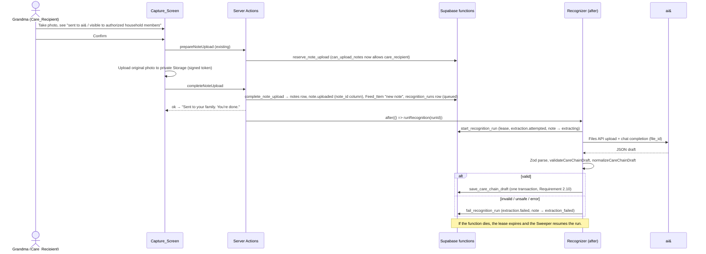
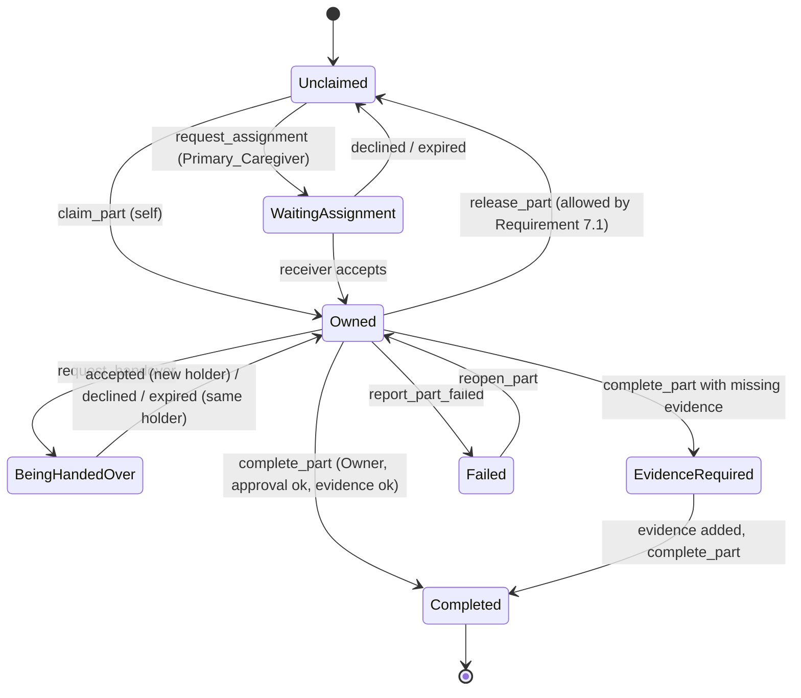
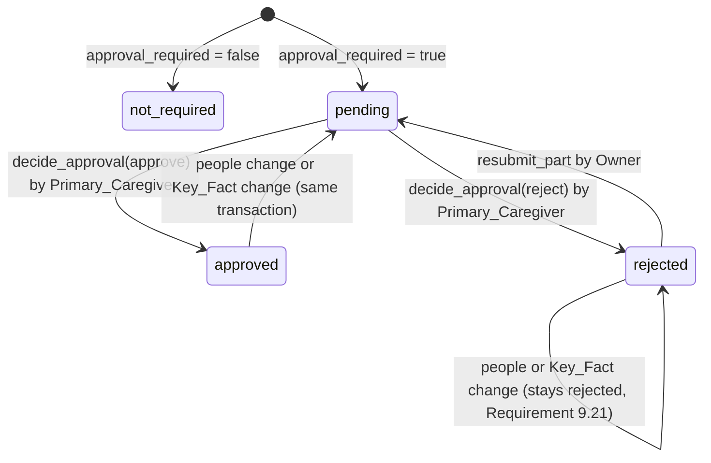
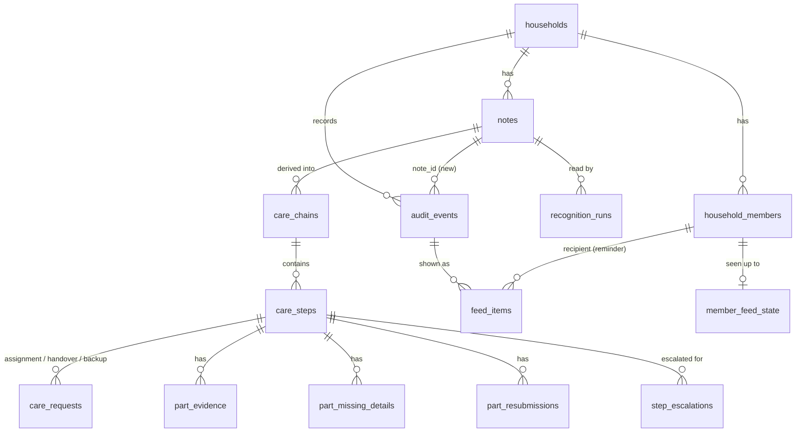

# Design Document: Family Shared Care

## Overview

This design rebuilds the signed-in Fudepan flow so that one handwritten note becomes one **Shared_Care_Event** that the whole household works on together. It implements every requirement in `requirements.md` (Requirements 1 to 21) on top of the existing foundation ("option A"): Supabase Auth, `households` and `household_members`, row-level security (RLS), private Storage for note photos, the server-only ai& client with Zod validation, `care_chains`, `care_steps`, and the append-only `audit_events` table.

The design follows one rule for every state change, taken from the existing `save_appointment_clarification` work:

```text
Server Action  ->  Zod input schema  ->  service (injectable store)  ->  service-role plpgsql function
                                                                         1. lock the care_steps row (FOR UPDATE)
                                                                         2. re-check active membership and role now
                                                                         3. apply the rule (Action_Guard)
                                                                         4. write the change, its audit event,
                                                                            its Feed_Item and any In_App_Reminders
                                                                         all in one transaction
```

Browser roles (`anon`, `authenticated`) cannot execute any of these functions. They can only read their own households' rows through RLS.

### Goals

- A Care_Recipient photographs a note and is done (Requirement 1). Recognition runs on the server and keeps running after the page closes (Requirement 2.14).
- Every Part has visible responsibility: Owner, Driver, Companion, Backup_Owner, pending requests, three separately labelled times, and what happens if nobody responds (Requirements 3, 5 to 8, 12).
- Claiming and approving are separate acts. Approval_State is stored apart from Progress_Status, and any change of people or Key_Facts on an approved High_Risk_Part resets approval in the same transaction (Requirement 9).
- The old `/care` server actions call the same Action_Guard, so the new rules hold on old pages too (Requirements 5.19, 9.13, 11.8, 18.5, 21.3).
- The core flow works in Japanese (Requirement 17.8 to 17.11).

### Non-goals

- Visual restyling, external notification channels, calendar integration, removing the old pages (see Out of Scope in `requirements.md`).

### Key design decisions

| # | Decision | Rationale |
|---|---|---|
| K1 | **The Action_Guard lives in plpgsql functions**, mirrored by a pure TypeScript rule module (`src/lib/care/rules/`) used for fast pre-checks, UI state, and property-based tests. | Only the database can check role, active status, and the count of active Primary_Caregivers at processing time inside the same transaction as the write (Requirement 9.14). Row locks give first-claim-wins (Requirement 5.4). The TypeScript mirror is the test oracle; pgTAP keeps the two in step. |
| K2 | **Approval_State is a new nullable column `care_steps.approval_state`.** `null` means "legacy row, derive on read" (Requirement 18.6). Every write function materializes the derived value before changing it (Requirement 18.7). | Additive, no rewrite of QA rows, and Progress_Status changes can never touch it (Requirement 9.8). |
| K3 | **Owner stays in `care_steps.owner_id`; Driver and Companion are new columns `driver_id` and `companion_id`.** | The requirements name `owner_id` as the Owner. One column per Helper_Role makes "at most one Owner, Driver, Companion" (Requirement 6.3) a property of the table shape. The same Member may hold several columns (Requirement 6.4). |
| K4 | **One `care_requests` table for Assignment, Handover, and Backup_Request**, each with `expires_at`. A partial unique index allows one pending request per Part, kind, and Helper_Role. | The three requests have the same lifecycle (pending, accepted, declined, expired). Holders never change until acceptance (Requirements 5.9, 5.14, 8.3). |
| K5 | **Recognition uses a `recognition_runs` job row plus Next.js `after()`, with a sweeper as safety net.** | `after()` runs the callback after the response is sent, for the route's configured `maxDuration` ([Next.js `after`](https://nextjs.org/docs/app/api-reference/functions/after)). The job row with a lease and a partial unique index gives one running run per note (Requirement 2.13) and lets a sweeper resume runs that died with the function. |
| K6 | **One SQL function `save_care_chain_draft` writes chain, Parts, success event, backfill, and note state in one transaction** (Requirements 2.10, 2.11, 2.16). | The current `runExtraction` writes these with separate PostgREST calls and can leave a chain without Parts. |
| K7 | **Feed_Items are stored rows (`feed_items`)**, written by the same SQL function as the action. An In_App_Reminder is a Feed_Item with `recipient_member_id` set. Feed text is rendered at read time from codes, in the reader's language. | Stored rows give "exactly one Feed_Item per action" (Requirement 4.2), per-Member seen state (Requirements 4.3, 19.2), and household-scoped RLS. Codes instead of stored text keep sensitive words out (Requirement 4.6) and allow Japanese rendering (Requirement 17.8). |
| K8 | **Early audit events link to the note through a new nullable column `audit_events.note_id`** with a same-household composite foreign key. *Default pending confirmation (D-5).* | See "Note linkage for audit events" below. |
| K9 | **i18n uses typed dictionary modules (`en`, `ja`)** and a per-membership `ui_language` column. No i18n framework. | Two languages, server-rendered pages, and a small label set. TypeScript forces the Japanese dictionary to have every key, so a missing translation fails `pnpm typecheck`. |
| K10 | **Escalation moves into one SQL function `escalate_due_parts`** with an escalation ledger table that has a unique key per Part, deadline kind, and deadline value. | Requirement 12.3 (exactly one escalation per deadline value) becomes a unique constraint. Reminders, Feed_Item, status change, and audit event commit together. |

### Research notes

- **`after()` on Vercel.** `after` from `next/server` runs after the response is finished and is bounded by the route's default or configured `maxDuration`; it can be called from Server Functions and Route Handlers ([Next.js docs: after](https://nextjs.org/docs/app/api-reference/functions/after)). It does not survive a crash or a timeout of the function, so it is paired with the `recognition_runs` lease and a sweeper. Content was rephrased for compliance with licensing restrictions.
- **Existing code facts that shape this design** (read from the repository):
  - `src/app/(app)/care/actions.ts`: `approveStep` has no role check and sets `status = 'approved'`; `assignStepOwner` writes `owner_id` and `backup_owner_id` directly; `completeStep` checks `status = 'approved'`; `addTextEvidence` writes the evidence text into the audit payload, which conflicts with Requirement 15.3; audit inserts are separate calls that can fail after the update.
  - `src/lib/care/extraction.ts`: chain, success event, and steps are separate writes; the step insert failure leaves a chain marked `extraction_failed`; `note.status = 'pending_review'` short-circuits re-runs, but two concurrent runs can both create chains.
  - `src/lib/care/escalation.ts`: reads `escalation_at`, skips appointment steps through `hasModelOnlyDeadline`, writes `step_escalated` and a simulated `escalation_notified` event as separate inserts.
  - `src/lib/care/risk.ts`: `RISK_LABELS.high` is "Requires confirmation", but the accessibility steering and Requirement 17.2 say "High risk". This is fixed in implementation (see Components, "Labels").
  - `supabase/migrations/20261121000000_note_uploads.sql`: `private.can_upload_notes` excludes `care_recipient`; `note.uploaded` keeps the note ID only in the payload.
  - `src/lib/log.ts` already masks logs through an allow-list of fields and safe value shapes. New fields are added to the allow-list only if they are IDs or codes.
  - Vitest runs in the `node` environment with `renderToStaticMarkup`; there is no property-based testing library yet.

## Architecture

### System context

```mermaid
flowchart LR
  subgraph Browser["Phone browser"]
    CAP[Capture_Screen]
    FEED[Family_Feed]
    EV[Event_View]
    RV[Recipient_View]
    OLD[Old /notes and /care pages]
  end

  subgraph Vercel["Next.js on Vercel (server only)"]
    SA[Server Actions<br/>Zod input]
    SVC[Services<br/>src/lib/care/*, src/lib/family/*]
    REC[Recognizer<br/>after() + recognition_runs]
    SWEEP[Sweeper<br/>on-open check + Vercel Cron]
    RULES[Pure rule module<br/>src/lib/care/rules]
    I18N[Dictionaries en / ja]
  end

  subgraph Supabase
    FN[Service-role plpgsql functions<br/>= Action_Guard]
    DB[(PostgreSQL + RLS)]
    ST[(Private Storage<br/>notes, evidence)]
  end

  AI[ai& API<br/>Files + Chat Completions]

  CAP -->|signed upload| ST
  CAP --> SA
  FEED --> SA
  EV --> SA
  OLD --> SA
  SA --> SVC
  SVC --> RULES
  SVC -->|rpc, service role| FN
  FN --> DB
  REC -->|read photo| ST
  REC -->|server-side only| AI
  REC -->|rpc| FN
  SWEEP --> REC
  SWEEP -->|rpc| FN
  FEED -.->|RLS reads| DB
  EV -.->|RLS reads| DB
  RV -.->|RLS reads| DB
  FEED --- I18N
```

### Capture and recognition sequence



### Responsibility lifecycle of a Part



Approval_State runs alongside this lifecycle and never changes because of a Progress_Status change:



### Recognition lifecycle on Vercel (K5)

1. `complete_note_upload` inserts a `recognition_runs` row with `status = 'queued'` in the same transaction as the note row, so a stored photo always has a run.
2. The `completeNoteUpload` server action calls `after(() => recognizer.run(runId))`. The capture page sets `export const maxDuration = 60` so the action and its `after` callback have a known budget. The ai& request uses an `AbortSignal.timeout` shorter than that budget.
3. `start_recognition_run` moves the run to `running` with `lease_expires_at = now() + 3 minutes` only if no other run of the note is `running` with a live lease. A partial unique index on `(note_id) where status in ('queued','running')` blocks a second active run (Requirement 2.13).
4. On success `save_care_chain_draft` commits the draft and marks the run `succeeded`. On failure `fail_recognition_run` marks it `failed`.
5. **Sweeper.** Two triggers call `resume_stale_recognition_runs` and `escalate_due_parts`:
   - An on-open check: when a Member opens the Family_Feed or an Event_View, the server runs the sweep for that household at most once per minute (throttled through `household_sweeps.last_run_at`). It resumes stale runs through `after()`.
   - A Vercel Cron Route Handler (`/api/cron/sweep`, protected by `CRON_SECRET`). The cron frequency depends on the Vercel plan, so the on-open check is the main path in the Alpha; the cron covers households nobody opens.
6. A retry from an `extraction_failed` event creates a new run on the same note and photo (Requirement 2.15).

Alternatives considered: a pure DB job queue with an external worker (more infrastructure than the Alpha needs); running recognition inside the request before responding (breaks Requirement 2.14 when the page closes and makes the Care_Recipient wait); Supabase Edge Functions (would move the ai& key and client into a second runtime). `after()` plus a lease keeps everything in the existing Next.js server code.

### Route map

New routes live in a new route group with its own layout so the Recipient_View has no other navigation (Requirement 13.1). Old `/notes` and `/care` routes stay (Requirement 18.1).

| Route | Screen | Who |
|---|---|---|
| `/family` | Family_Feed for Family_Members; Recipient_View for a Care_Recipient (chosen on the server from the Member's role) | all Members |
| `/family/capture` | Capture_Screen | all Members (Requirement 1.4) |
| `/family/events/[noteId]` | Event_View (keyed by note, so "Being read" works before any chain exists) | Family_Members; a Care_Recipient is redirected to the recipient detail |
| `/family/events/[noteId]/timeline` | Timeline | Family_Members |
| `/family/me/[noteId]` | Recipient detail (read-only sentences) | Care_Recipient |
| `/family/settings/language` | Language setting | all Members |
| `/notes/[noteId]/image` | Existing membership-checked image route, reused for the "View original note" link | all Members |
| `/api/cron/sweep` | Route Handler for Vercel Cron | Vercel Cron only (`Authorization: Bearer ${CRON_SECRET}`) |

All new pages are Server Components that read with the RLS client from `getSession()`. Interactive parts are small Client Components that call Server Actions. With `cacheComponents` enabled, every page that reads session data awaits `getSession()` (which calls `connection()`) inside a `<Suspense>` boundary, as the existing pages do.

## Components and Interfaces

### Module layout

```text
src/lib/care/rules/          pure, no I/O, shared by services, UI, and tests
  approval.ts                effectiveApprovalState, nextApprovalStateOnChange, decideApproval, canResubmit
  claims.ts                  decideClaim, decideRelease, helperRolesOffered, isHighRiskPart
  requests.ts                handoverExpiry, requestExpiry, decideRequestResponse
  completion.ts              decideCompletion
  escalation.ts              escalationCandidates (oracle for escalate_due_parts)
  labels.ts                  riskLabelKey, approvalLabelKey (Requires confirmation iff pending)
  missing-details.ts         deriveMissingDetails
  refusals.ts                RefusalCode union and mapping to message keys
src/lib/care/
  part-actions.ts            createPartActionService({ store, log }) + createSupabasePartActionStore(admin, log)
  recognition.ts             createRecognizer({ store, ai, storage, log }) (replaces runExtraction)
  escalation.ts              thin wrapper over escalate_due_parts (keeps detectAndMarkEscalated name for old callers)
  timeline.ts                getEventTimeline(noteId) gathers by note_id and care_chain_id
  queries.ts                 + getSharedCareEvent(noteId), listFeed(householdId, memberId)
  risk.ts                    RISK_LABELS.high = "High risk"
  step-state.ts              isAwaitingApproval reads effectiveApprovalState
src/lib/family/
  feed.ts                    renderFeedItem(item, dict, names), partReference(step, dict)
  recipient-sentences.ts     sentenceForPart(part, dict)
  sweep.ts                   runHouseholdSweep(householdId) throttled
src/lib/i18n/
  en.ts, ja.ts               typed dictionaries (ja: Messages = {...} must have every key)
  language.ts                resolveLanguage(memberLanguage, acceptLanguage)
  format.ts                  formatInZone(instant, timeZone, lang)
src/app/(family)/family/...  pages listed in the Route map
src/app/(family)/family/actions.ts  new Server Actions
src/app/api/cron/sweep/route.ts
```

### Pure rule module (`src/lib/care/rules`)

All functions take plain data (a `PartSnapshot`, an actor `MemberSnapshot`, the household's active Primary_Caregiver count, and `now`) and return a decision. They never read the clock or the database themselves.

```ts
type HelperRole = "owner" | "driver" | "companion";
type ApprovalState = "not_required" | "pending" | "approved" | "rejected";
type ProgressStatus =
  | "pending_review" | "needs_clarification" | "in_progress" | "evidence_required"
  | "escalated" | "completed" | "failed" | "cancelled";

type PartSnapshot = {
  id: string; householdId: string; careCategory: CareCategory; riskLevel: RiskLevel;
  approvalRequired: boolean; storedApprovalState: ApprovalState | null; legacyStatus: string;
  ownerId: string | null; driverId: string | null; companionId: string | null; backupOwnerId: string | null;
  taskDue: ConfirmedTime | null; respondBy: ConfirmedTime | null;
  evidenceRequired: string[]; evidenceAttached: string[];
  planVersion: number; rejectedAtPlanVersion: number | null;
};
type ConfirmedTime = { at: Date; timeZone: string; provenance: "human_confirmed" | "model_suggested" };
type MemberSnapshot = { memberId: string; householdId: string; role: HouseholdRole; isActive: boolean };

type Decision<T> = { ok: true; value: T } | { ok: false; code: RefusalCode };

effectiveApprovalState(part): ApprovalState                     // Requirement 18.6
isHighRiskPart(part): boolean                                   // glossary High_Risk_Part
helperRolesOffered(part): HelperRole[]                          // owner always; driver+companion if travel (6.1, 6.7)
decideClaim(part, actor, role): Decision<PartSnapshot>          // 5.1–5.5, 5.13, 6.2–6.4, 9.22
decideRelease(part, actor, role, now): Decision<PartSnapshot>   // 7.1, 7.2, 9.22
nextApprovalStateOnChange(state, change): ApprovalState         // 9.9, 9.21, 9.22
decideApproval(part, actor, activePrimaryCount, decision): Decision<{ state; selfApproval }> // 9.2–9.7, 9.16
canResubmit(part, actor, input): Decision<ApprovalState>        // 9.17–9.19
decideCompletion(part, actor): Decision<"completed" | "evidence_required"> // 11.1, 11.3, 11.6, 11.7
handoverExpiry(part, requestedAt): Date                          // glossary Handover_Expiry_Time, 8.10
decideRequestResponse(request, part, actor, now, accept): Decision<...> // 5.10, 5.11, 8.4–8.6, 8.9, 8.11
escalationCandidates(parts, ledger, now): EscalationPlan[]       // 12.1–12.3, 12.6–12.12
approvalLabelKey(part): "requiresConfirmation" | "confirmed" | "notApproved" | "done" | null // 9.10–9.12, 17.2
riskLabelKey(riskLevel): "lowPriority" | "needsAttention" | "highRisk"
deriveMissingDetails(part, storedDetails): MissingDetail[]       // 6.5, 10.1, 10.5, 12.4
```

`helperRolesOffered` returns Driver and Companion for `appointment` and `transport` Parts. It never offers a Helper_Role for shopping or medicine pickup (Requirement 6.7); those are separate Parts with only the Owner Claim.

### Refusal codes

Every SQL function raises `P0001` with one of these messages, except where a refusal must still commit a change (see "Refusals that commit"). The store maps the message to a `RefusalCode`; the service maps the code to a dictionary key. Unknown errors become `error` and are logged with `errorCode()` only.

| Code | Meaning | Plain-language message (en) |
|---|---|---|
| `part_not_found` | Part does not exist **or** the actor is not an active Member of its household | "This could not be found, or you do not have access to it." (same text for both, Requirement 14.2) |
| `recipient_read_only` | Actor is a Care_Recipient | "You can see this, but your family takes care of it." |
| `not_primary_caregiver` | Assignment or approval by a non-Primary_Caregiver | "Only a primary caregiver can do this." |
| `self_approval_blocked` | Owner approving own Part with 2+ active Primary_Caregivers | "Another primary caregiver needs to confirm this." |
| `resubmission_required` | Approving a `rejected` Part | "{Owner} needs to send this again before it can be confirmed." |
| `resubmission_empty` | No explanation, Evidence, or changed plan | "Add a short explanation, a photo or file, or change the plan." |
| `not_rejected` | Resubmitting a Part that is not `rejected` | "This does not need to be sent again." |
| `approval_not_required` | Approving a Part with `approval_required = false` | "This does not need confirmation." |
| `already_claimed` | Helper_Role already held (first commit wins) | "{name} already said they will do this." |
| `role_not_offered` | Driver or Companion on a Part without travel | "This part has no driver or companion." |
| `release_blocked_due_soon` | Requirement 7.2 | "This is due soon or overdue, so you can't just drop it. Hand it to someone instead." |
| `not_holder` | Release or Handover by someone who does not hold the role | "You are not doing this part." |
| `receiver_not_eligible` | Receiver is inactive, a Care_Recipient, in another household, or the actor | "Choose another family member." |
| `request_pending` | A pending request of the same kind and role exists | "There is already a request waiting for an answer." |
| `request_not_found` | Request does not exist or actor is not its receiver | same text as `part_not_found` |
| `request_not_pending` | Already answered | "This request was already answered." |
| `request_expired` | Accepted after `expires_at` (committed, see below) | "This request has expired. Nothing changed." |
| `not_owner` | Completion, resubmission by someone other than the Owner | "Only {Owner} can mark this as done." / "Only {Owner} can send this again." |
| `approval_pending` | Completion while approval required and not `approved` | "This needs to be confirmed by a primary caregiver first." |
| `not_failed` | Reopen of a Part that is not `failed` | "This part is not marked as failed." |
| `not_allowed_reopen` | Reopen by someone other than Owner or Primary_Caregiver (D-2) | "Only {Owner} or a primary caregiver can reopen this." |
| `not_allowed_backup_request` | Backup_Request by someone other than Owner or Primary_Caregiver (D-2) | "Only {Owner} or a primary caregiver can ask for a backup." |
| `part_closed` | Change on a `completed` or `cancelled` Part | "This part is already finished." |
| `invalid_input` | Value failed database validation | field-specific message from the service |
| `recognition_running` | Second run while one is active | "This note is being read." |
| `error` | Anything else | "Something went wrong. Nothing was changed. Please try again." |

**Refusals that commit.** Two outcomes must persist even though the action did not succeed, so the functions return a JSON outcome instead of raising (raising would roll the change back):

- `respond_to_request` with acceptance after `expires_at` closes the request as `expired`, writes the not-accepted audit event, Feed_Item, and reminders, and returns `{ outcome: "expired" }` (Requirement 8.11).
- `complete_part` with missing Evidence sets Progress_Status `evidence_required` and returns `{ outcome: "evidence_required", missing: [...] }` (Requirement 11.3).

### SQL functions (Action_Guard)

All functions: `language plpgsql`, `set search_path = ''`, `revoke all ... from public, anon, authenticated`, `grant execute ... to service_role`. `p_user_id` is the verified user from `getSession()`. Each function resolves the actor Member with `private.actor_member(p_household_id, p_user_id)`, which reads `household_members` at that moment (`is_active`, `role`), so no cached value is used (Requirement 9.14). Every function locks the `care_steps` row first (`select ... for update`), then any `care_requests` row, so lock order is the same everywhere and deadlocks cannot form.

Shared private helpers:

| Helper | Purpose |
|---|---|
| `private.actor_member(household_id, user_id) returns public.household_members` | Active membership of the actor, or null |
| `private.effective_approval_state(step public.care_steps) returns text` | `coalesce(approval_state, derived)`; derivation of Requirement 18.6 |
| `private.apply_people_change(step, changed_role text)` | If effective state is `approved` and the Part is high-risk: set `approval_state = 'pending'`, bump `plan_version`, write `approval.reset` (payload: `changed: 'owner'|'driver'|'companion'`), reminders for every active Primary_Caregiver. If `rejected`: bump `plan_version`, keep `rejected` (9.21). Always stores the materialized state (18.7). |
| `private.apply_key_fact_change(step, fact text)` | Same as above with `changed: 'location'|'appointment_time'|'amount'` (9.9, 9.24) |
| `private.write_audit(...) returns uuid` | Insert with `note_id`, `created_at = clock_timestamp()` so events in one transaction keep their order |
| `private.add_feed_item(household, note, chain, step, kind, actor_member, params, audit_id)` | One household Feed_Item |
| `private.add_reminder(household, ..., recipient_member, kind, params)` | One Feed_Item addressed to one Member plus one `reminder.sent` audit event with `channel: 'in_app'` (Requirement 19.3) |
| `private.is_high_risk(step)` | Same rule as `isHighRiskPart` |

Function list:

| Function | Signature | Writes (one transaction) | Refusals | Requirements |
|---|---|---|---|---|
| `claim_part` | `(p_step_id uuid, p_user_id uuid, p_role text) returns jsonb` | sets `owner_id` / `driver_id` / `companion_id` to actor; `pending_review → in_progress` for owner; `part.claimed` / `part.driver_volunteered` / `part.companion_volunteered`; Feed_Item; approval reset via `apply_people_change` when the holder changes on an approved Part | `part_not_found`, `recipient_read_only`, `already_claimed`, `role_not_offered`, `part_closed` | 5.1–5.6, 5.13, 6.2–6.4, 9.22 |
| `release_part` | `(p_step_id uuid, p_user_id uuid, p_role text) returns jsonb` | clears role column; `part.released`; Feed_Item "needs someone"; approval reset | `part_not_found`, `not_holder`, `release_blocked_due_soon`, `part_closed` | 7.1–7.4, 9.22, 21.4 |
| `request_assignment` | `(p_step_id uuid, p_user_id uuid, p_to_member_id uuid) returns jsonb` | `care_requests(kind='assignment', helper_role='owner', expires_at = now()+24h)`; `assignment.requested`; reminder to receiver; Feed_Item | `part_not_found`, `recipient_read_only`, `not_primary_caregiver`, `receiver_not_eligible`, `request_pending`, `part_closed` | 5.7, 5.9, 5.12, 21.1 |
| `request_handover` | `(p_step_id uuid, p_user_id uuid, p_role text, p_to_member_id uuid) returns jsonb` | `care_requests(kind='handover', expires_at = handover expiry)`; `handover.requested` (payload includes `expires_at`, `expiry_rule: 'task_due'|'24h'`); reminder; Feed_Item | `part_not_found`, `recipient_read_only`, `not_holder`, `receiver_not_eligible`, `request_pending`, `part_closed` | 8.1–8.3, 8.8, 8.10 |
| `request_backup` | `(p_step_id uuid, p_user_id uuid, p_to_member_id uuid) returns jsonb` | `care_requests(kind='backup', expires_at = now()+24h)`; `backup.requested`; reminder; Feed_Item | `part_not_found`, `recipient_read_only`, `not_allowed_backup_request`, `receiver_not_eligible`, `request_pending` | 5.14, 21.5, D-1, D-2 |
| `volunteer_backup` | `(p_step_id uuid, p_user_id uuid) returns jsonb` | `backup_owner_id = actor`; `backup.accepted` (payload `volunteered: true`); Feed_Item | `part_not_found`, `recipient_read_only`, `already_claimed`, `invalid_input` (actor is Owner, existing check) | 5.17 |
| `respond_to_request` | `(p_request_id uuid, p_user_id uuid, p_accept boolean) returns jsonb` | accept: moves holder (or sets `backup_owner_id`), request `accepted`, `assignment.accepted` / `handover.accepted` / `backup.accepted`, approval reset if people changed, Feed_Item. Decline: request `declined`, `*.declined`, reminder to requester, Feed_Item. Expired at processing time: request `expired`, `*.not_accepted` / `*.expired`, reminders to requester and receiver, returns `{outcome:'expired'}` | `request_not_found`, `request_not_pending`, `receiver_not_eligible` (receiver became inactive), `part_closed` | 5.10, 5.11, 5.15, 5.16, 8.4–8.7, 8.11, 8.12, 21.6 |
| `expire_care_requests` | `(p_household_id uuid) returns integer` | for every pending request past `expires_at`: same writes as the expired branch above | none (system) | 8.6, 8.9, 8.12, D-1 |
| `decide_approval` | `(p_step_id uuid, p_user_id uuid, p_decision text) returns jsonb` | `approval_state = 'approved'|'rejected'`, `approval_decided_by`, `rejected_at_plan_version` on reject; `approval.given` (payload `self_approval`) or `approval.rejected`; Feed_Item; Progress_Status untouched | `part_not_found`, `recipient_read_only`, `approval_not_required`, `not_primary_caregiver`, `self_approval_blocked`, `resubmission_required`, `part_closed` | 9.2, 9.5–9.7, 9.13, 9.14, 9.16 |
| `resubmit_part` | `(p_step_id uuid, p_user_id uuid, p_explanation text, p_evidence_ids uuid[]) returns jsonb` | `part_resubmissions` row (explanation text stays in this table); `approval_state = 'pending'`; `approval.resubmitted` (payload `added: ['explanation','evidence','changed_plan']`); reminders to every Primary_Caregiver; Feed_Item | `part_not_found`, `recipient_read_only`, `not_owner`, `not_rejected`, `resubmission_empty` | 9.17–9.20 |
| `complete_part` | `(p_step_id uuid, p_user_id uuid) returns jsonb` | `completed` + `part.completed` + Feed_Item, or `evidence_required` + `part.evidence_missing` + Feed_Item (committed outcome) | `part_not_found`, `recipient_read_only`, `not_owner`, `approval_pending`, `part_closed` | 9.3, 11.1, 11.3, 11.6–11.8 |
| `report_part_failed` | `(p_step_id uuid, p_user_id uuid, p_reason_code text) returns jsonb` | `failed`; `part.failed`; Feed_Item "needs attention" | `part_not_found`, `recipient_read_only`, `not_holder`, `part_closed` | 11.4 |
| `reopen_part` | `(p_step_id uuid, p_user_id uuid) returns jsonb` | `failed → in_progress`; `part.reopened`; Feed_Item | `part_not_found`, `recipient_read_only`, `not_failed`, `not_allowed_reopen` | 12.13, D-2 |
| `record_evidence` | `(p_step_id uuid, p_user_id uuid, p_label text, p_kind text, p_storage_path text, p_text text) returns jsonb` | `part_evidence` row (path or text, never in audit); `evidence.uploaded` (payload: `kind`, `label_index`); Feed_Item | `part_not_found`, `recipient_read_only`, `not_holder` (any Helper may add), `invalid_input` | 11.2 |
| `confirm_part_time` | `(p_step_id uuid, p_user_id uuid, p_kind text, p_at timestamptz, p_timezone text) returns jsonb` | `respond_by_*` or `task_due_*` with `provenance = 'human_confirmed'`, `*_set_by`; `time.confirmed` (payload `kind`, ISO value, zone); Feed_Item "missing detail resolved" when it resolves one | `part_not_found`, `recipient_read_only`, `invalid_input` (unknown zone, outside 2000–2100), `part_closed` | 10.7, 12.6 |
| `save_appointment_clarification` | same signature as today `(uuid, uuid, text, timestamptz, text) returns jsonb` | **replaced with `create or replace`**: existing writes + `recipient_read_only` + `apply_key_fact_change` for location and time when the values change + `note_id` on the audit event + Feed_Item | existing codes + `recipient_read_only`, `part_closed` | 10.2, 9.9, 9.24 |
| `save_part_amount` | `(p_step_id uuid, p_user_id uuid, p_amount_minor bigint, p_currency text) returns jsonb` | `required_amount_minor`, `amount_currency`; `missing_detail.resolved` (payload `kind: 'amount'`, no value); key fact reset | `part_not_found`, `recipient_read_only`, `invalid_input`, `part_closed` | 9.9, 10.3 |
| `resolve_missing_detail` | `(p_detail_id uuid, p_user_id uuid, p_answer text) returns jsonb` | `part_missing_details.resolved_*` and `answer` (answer stays in this table); `missing_detail.resolved` (payload `kind`); Feed_Item | `part_not_found`, `recipient_read_only`, `invalid_input` | 10.1, 10.3, 4.2 |
| `complete_note_upload` | same signature; **replaced** | existing writes + `audit_events.note_id` + Feed_Item `event_created` + `recognition_runs(queued)` | existing codes | 1.3, 1.8, 4.8, 15.7 |
| `private.can_upload_notes` | same signature; **replaced** | allows every active Member, including `care_recipient` | — | 1.4, D8 |
| `start_recognition_run` | `(p_note_id uuid, p_user_id uuid, p_actor text) returns jsonb` | queued/stale run → `running`, `lease_expires_at`, `attempt + 1`; note → `extracting`; `extraction.attempted` | `part_not_found` (note not visible), `recognition_running`, `recognition_done` (a Usable_Draft exists; returns its chain id) | 2.1, 2.12, 2.13, 2.15 |
| `save_care_chain_draft` | `(p_run_id uuid, p_draft jsonb) returns jsonb` | see "Draft-saving transaction" | `run_not_running`, `invalid_input` (raises, rolls back) | 2.3, 2.10, 2.11, 2.16 |
| `fail_recognition_run` | `(p_run_id uuid, p_reason_code text) returns jsonb` | run `failed`; note `extraction_failed`; `extraction.failed` (reason code only); Feed_Item "could not read" | `run_not_running` | 2.4, 2.5, 2.11 |
| `resume_stale_recognition_runs` | `(p_household_id uuid) returns setof uuid` | marks runs with expired lease as `queued` again (attempt cap 3, then `failed` via `fail_recognition_run` logic) | — | 2.14 |
| `escalate_due_parts` | `(p_household_id uuid) returns integer` | see "Escalation changes" | — | 12.1–12.14 |
| `mark_feed_seen` | `(p_user_id uuid, p_household_id uuid, p_until timestamptz) returns void` | `member_feed_state.last_seen_at`; reminders addressed to the Member get `seen_at` | `part_not_found` (not a member) | 4.3, 19.2 |
| `set_member_language` | `(p_user_id uuid, p_household_id uuid, p_language text) returns void` | `household_members.ui_language` | `invalid_input` | 17.7 |

Return shape for Part functions: `{ audit_event_id, care_chain_id, note_id, outcome, approval_reset: boolean }`, validated with Zod in the store, like `rpcResult` in `appointment-clarification.ts`.

#### Draft-saving transaction (`save_care_chain_draft`)

```text
1. lock notes row (FOR UPDATE) and the run row; run must be 'running' with this run id
2. if a Usable_Draft already exists for the note → mark run 'superseded', return existing chain id (no writes) [2.12]
3. insert care_chains                                         [2.10 step 1]
4. insert all care_steps with audit_event_id = null, approval_state = 'not_required' | 'pending',
   person_to_ask, suggested_role, no due/escalation times on appointment Parts   [2.6, 2.10 step 2, 10.6]
5. insert part_missing_details rows from ambiguities that name a step
6. insert extraction.succeeded audit (actor 'ai', note_id, care_chain_id, counts only)  [2.10 step 3]
7. update care_steps set audit_event_id = <6> where care_chain_id = <3>                 [2.10 step 4, 2.16]
8. update notes set status = 'pending_review' (shown as ready)                          [2.10 step 5]
9. update run set status = 'succeeded', care_chain_id = <3>
10. Feed_Item 'event_ready'
```

Any error raises and rolls back steps 3 to 10 (Requirement 2.11). The Recognizer then calls `fail_recognition_run` in a new transaction. The function also re-applies the safety checks of `validateCareChainDraft` in SQL (high-risk → approval required is already a table constraint) and refuses a draft with more than 50 steps.

`extraction.succeeded` doubles as the "Care_Chain created" record of Requirement 15.1, so the draft writes exactly one primary audit event. The old `ambiguities_detected` event with free-text questions is no longer written; ambiguities are stored in `part_missing_details`.

### Services and Server Actions

Each service follows `createAppointmentClarificationService`: a factory with `{ store, log }`, Zod parsing, mapping refusal codes to message keys, and masked logs. Services return `{ ok: true, ... } | { ok: false, error: MessageKey, params }`. Server Actions translate the key with the Member's dictionary, call `revalidatePath` for the event, feed, and timeline, and return `ActionResult`.

New Server Actions in `src/app/(family)/family/actions.ts`:

| Action | Input (Zod) | Service call |
|---|---|---|
| `claimPart` | `{ stepId: uuid, role: enum(owner, driver, companion) }` | `partActions.claim` |
| `releasePart` | `{ stepId, role }` | `partActions.release` |
| `assignPart` | `{ stepId, toMemberId: uuid }` | `partActions.requestAssignment` |
| `handOverPart` | `{ stepId, role, toMemberId }` | `partActions.requestHandover` |
| `askForBackup` / `volunteerAsBackup` | `{ stepId, toMemberId? }` | `partActions.requestBackup` / `volunteerBackup` |
| `answerRequest` | `{ requestId: uuid, accept: boolean }` | `partActions.respond` |
| `approvePart` / `rejectPart` | `{ stepId }` | `partActions.decideApproval` |
| `resubmitPart` | `{ stepId, explanation: string.trim().max(1000).optional(), evidenceIds: uuid[].max(10) }` | `partActions.resubmit` |
| `markPartDone` | `{ stepId }` | `partActions.complete` |
| `reportPartFailed` / `reopenPart` | `{ stepId, reasonCode? }` | `partActions.fail` / `reopen` |
| `prepareEvidenceUpload` / `completeEvidenceUpload` / `addTextEvidence` | follow the note upload pattern with a private `evidence` bucket | `evidence.*` |
| `confirmPartTime` | `{ stepId, kind: enum(respond_by, task_due), localDate, localTime, timeZone }` | uses `zonedTimeToInstant` then `partActions.confirmTime` |
| `saveAppointmentDetails` | existing `appointmentClarificationInput` | existing service |
| `retryRecognition` | `{ noteId: uuid }` | `recognizer.start(noteId, user)` then `after(run)` |
| `markFeedSeen` | `{ householdId, until: iso }` | `feed.markSeen` |
| `setLanguage` | `{ householdId, language: enum(en, ja) }` | `members.setLanguage` |

`completeNoteUpload` (existing action in `src/app/(app)/notes/actions.ts`) is extended to schedule recognition with `after()` when the upload service returns the queued run id. The capture page reuses `prepareNoteUpload`, `completeNoteUpload`, and `reportNoteUploadFailure`.

### Rerouting the old `/care` actions

The old actions keep their names and signatures so the old pages keep working (Requirement 18.1), but their bodies call the same services (Requirement 18.5).

| Old action | New behavior |
|---|---|
| `assignStepOwner({ stepId, ownerId, backupOwnerId })` | Reads the current Part, then translates the request: `ownerId` = actor and unclaimed → `claim_part(owner)`; `ownerId` = another Member → `request_assignment` (refused for non-Primary_Caregivers); `ownerId = null` while set → `release_part(owner)` (Requirement 21.4); unchanged → no call. `backupOwnerId` = actor → `volunteer_backup`; another Member → `request_backup`; unchanged → no call; `null` while set → refused with "Backup changes need the backup's agreement" (*Default pending confirmation, D-6*). The action no longer writes `care_steps` or `audit_events` directly. |
| `approveStep({ stepId })` | `decide_approval(stepId, user, 'approve')`. The early "already approved" return uses `effectiveApprovalState`. |
| `completeStep({ stepId })` | `complete_part`. The `status === 'approved'` check is removed. |
| `addTextEvidence({ stepId, text })` | `record_evidence(kind='text')`. The text is stored in `part_evidence`, no longer in the audit payload (Requirement 15.3). |
| `runEscalationCheck(householdId)` | `escalate_due_parts` through the sweeper (membership checked by the function). |
| `triggerExtraction(noteId)` | `recognizer.start` + `after(run)`; returns "Being read" immediately when a run is active. |
| `saveAppointmentClarification` | unchanged service; the replaced SQL function adds approval reset and Recipient refusal. |

`src/lib/care/step-state.ts` (`isAwaitingApproval`) and `chain-summary.ts` switch to `effectiveApprovalState`, so the old pages show the same approval truth as the new ones.

### Recognizer (`src/lib/care/recognition.ts`)

```ts
createRecognizer({ store, ai: { extractCareChain }, storage: { readNoteImage }, log }) => {
  start(noteId, user | null): Promise<{ ok: true; runId } | { ok: false; code }>  // start_recognition_run
  run(runId): Promise<void>                                                         // never throws
}
```

`run` reads the photo with the service role (path from `notes.image_path`, never from the client), calls the existing `extractCareChain` (Files API upload, `file_id` in the chat request, file deleted afterwards), parses with `careChainDraftSchema`, applies `validateCareChainDraft` and `normalizeCareChainDraft`, and calls `save_care_chain_draft` or `fail_recognition_run` with a reason code. The ai& prompt is extended so each step may carry `person_to_ask` and each ambiguity may carry `step_index` and `kind`; both are optional in the Zod schema so older outputs still parse. `suggested_owner_role` is stored as `suggested_role` text only and never creates a Claim (Requirements 2.8, 5.3).

### Feed (`src/lib/family/feed.ts`)

- `listFeed` reads `feed_items` with the RLS client, newest first (`created_at desc, id desc`), limited to 50, for one household.
- The "Needs someone" section is derived at read time, not stored: events whose newest Usable_Draft has a Part with no Owner, an unresolved Missing_Detail, or a High_Risk_Part with no `human_confirmed` time (Requirements 4.4, 12.4, 12.10).
- `renderFeedItem(item, dict, names)` builds the text from `kind`, member display names, and `partReference(step, dict)`. For `medication`, `medical`, `payment`, and `document` Parts, `partReference` uses a generic phrase ("a medicine task", "a payment task", "a paperwork task") instead of the AI title, because titles can contain medication names or amounts (Requirement 4.6). Other categories use the title.
- New items are marked "New" in text when `created_at > member_feed_state.last_seen_at` (Requirement 4.3). A small Client Component polls `router.refresh()` every 30 seconds while the page is visible and announces "N new updates" in an `aria-live="polite"` region (Requirement 4.7).
- The unseen In_App_Reminder count appears as text in the family navigation ("2 reminders") (Requirement 19.2).
- When the UI tells a Member someone was notified, it uses "{name} has an in-app reminder" (Requirement 19.4).

### Event_View

Per Part, in this order: title (what needs to happen), Risk_Label, Approval_Label (only when there is one), Progress_Status in words, Helpers with roles or "Nobody yet", pending requests ("Waiting for Ken to accept", "Being handed to Misa until Thu 6:00 pm (Asia/Tokyo)"), Missing_Details as questions with reasons and the form to fill them, three times ("Appointment", "Reply by", "Done by"), each with its zone or "Not set yet", Evidence required with attached items, and "What happens if nobody responds" (Requirement 3.4) built from the Respond_By_Time and the Members who would get reminders. Literal dates from the quote appear as "Suggested from the note: '2:30 pm' — will be saved in Asia/Tokyo time" with a confirm button (Requirement 2.7). A Suggested_Role appears as "Suggestion: a family member who drives" with no claim (Requirement 2.8). A Person_To_Ask appears as "Ask Misa" (Requirement 10.4).

Buttons appear only when the rule module says the action is possible for this Member. When it is not, the button stays visible but disabled with the reason as text (for example "Mark as done" with "Requires confirmation by a primary caregiver", Requirement 9.1). The server re-checks everything regardless.

### Recipient_View

Large text (`text-xl` = 20 px minimum body, Requirement 13.4), 48 px minimum touch targets, one action ("Take a photo of your note"), and a read-only list of the household's Shared_Care_Events. Each Part becomes one sentence from `sentenceForPart` (Requirement 13.2), for example "Ken will drive you to the clinic on Fri, Nov 27 at 2:30 pm" or "Nobody has said they will pick up your glasses yet". No confidence scores, raw output, or codes (Requirement 13.6). Original note text is shown as written (Requirement 17.9).

### Capture_Screen

- Primary button opens `<input type="file" accept="image/jpeg,image/png,image/webp" capture="environment">`. A second, plain file input offers "Choose a photo instead" (Requirements 1.1, 1.2).
- After a photo is picked, the preview shows the consent text: "This photo will be sent to ai& to read it. Authorized household members can see it." and the buttons "Send to my family" and "Take the photo again" (Requirement 1.9).
- Client-side checks reuse `src/lib/notes/validation.ts` (signature and size) for an early message; the server checks again (Requirement 1.5).
- The `File` stays in component state until the server confirms, so "Try again" re-uploads without a new photo (Requirement 1.6).
- On success: "Sent to your family. You're done." (Requirement 1.7). Status changes are announced in an `aria-live` region.

### Timeline (`getEventTimeline`)

Reads with the RLS client: `audit_events where note_id = :noteId or care_chain_id in (chains of the note)` plus legacy events with `payload->>'note_id' = :noteId` and `note_id is null`. Results are de-duplicated by `id` (Requirement 15.8), ordered `created_at desc, id desc` for display (Requirement 15.4); the scenario check of Requirement 20.9 reads the same list in ascending order. Labels come from the dictionary; `approval.given` with `self_approval: true` is labelled "Self-approval" (Requirement 9.15). Legacy event types (`extraction_started`, `step_approved`, `owner_assigned`, `step_escalated`, ...) keep their existing labels.

### Labels

`src/lib/care/rules/labels.ts` is the only source of label keys:

| Key | en | ja |
|---|---|---|
| `lowPriority` | Low priority | 優先度：低 |
| `needsAttention` | Needs attention | 要注意 |
| `highRisk` | High risk | 高リスク |
| `requiresConfirmation` | Requires confirmation | 確認が必要 |
| `confirmed` | Confirmed | 確認済み |
| `notApproved` | Not approved | 承認されませんでした |
| `done` | Done | 完了 |

`approvalLabelKey` returns `done` when Progress_Status is `completed` (checked first), `requiresConfirmation` only when the effective Approval_State is `pending`, `confirmed` for `approved`, `notApproved` for `rejected`, and nothing for `not_required`. "Done" is used everywhere for a completed Part (*Default pending confirmation, D-4*). `src/lib/care/risk.ts` changes `RISK_LABELS.high` to "High risk" and re-exports the dictionary values, removing the mismatch with the accessibility steering.

### i18n

- `src/lib/i18n/en.ts` exports `const en = {...} as const` and `type Messages = DeepStringify<typeof en>`; `ja.ts` exports `const ja: Messages`. A missing key fails `pnpm typecheck`.
- `resolveLanguage(member.ui_language, acceptLanguage)`: the stored setting wins; otherwise `ja` if `Accept-Language` prefers Japanese; otherwise `en`.
- Dates use `Intl.DateTimeFormat` with `ja-JP` or `en-US` and the stored zone, through `formatInZone`.
- Error messages from services are keys, so they render in the Member's language (Requirement 17.8).
- Recognized original text and AI titles are never translated (Requirement 17.9).
- Old `/notes` and `/care` pages stay English.

### Note linkage for audit events (K8, *Default pending confirmation, D-5*)

Options:

| | A. `audit_events.note_id` column (recommended) | B. `payload.note_id` only (current practice) |
|---|---|---|
| Integrity | composite FK `(note_id, household_id) → notes(id, household_id)` makes a cross-household link impossible | none; any UUID can be written |
| Query | indexed `note_id = $1 or care_chain_id = any($2)` | JSON path filter, not indexed today |
| Migration | additive nullable column, existing rows untouched | nothing |
| Legacy | timeline also reads `payload->>'note_id'` for rows where `note_id is null` | same |

Recommendation: **A**, because the Timeline (Requirements 15.7, 15.8, 20.10) depends on this link, and a foreign key is the only way to guarantee the link stays inside the household. New functions set both `note_id` (column) and keep `note_id` in the payload where it is already written today, so existing readers keep working.

## Data Models

All changes are in new migrations after `20261202000000`. They only add tables, nullable columns, columns with constant defaults, constraints that existing rows already satisfy, indexes, and functions (`create or replace` for the three replaced functions). No existing row is rewritten.

### Migration order

1. `20261210000000_shared_care_columns.sql` — `care_steps`, `audit_events`, `household_members` columns and constraints.
2. `20261210000100_shared_care_tables.sql` — `care_requests`, `part_evidence`, `part_missing_details`, `part_resubmissions`, `feed_items`, `member_feed_state`, `recognition_runs`, `step_escalations`, `household_sweeps`, RLS, grants; private `evidence` bucket.
3. `20261210000200_shared_care_helpers.sql` — private helpers.
4. `20261210000300_shared_care_functions.sql` — Part functions.
5. `20261210000400_recognition_functions.sql` — recognition functions, replaced `complete_note_upload` and `can_upload_notes`.
6. `20261210000500_escalation_functions.sql` — `escalate_due_parts`, `expire_care_requests`, sweep helpers; replaced `save_appointment_clarification`.

### `care_steps` (new columns)

| Column | Type | Notes |
|---|---|---|
| `approval_state` | `text null` | check `in ('not_required','pending','approved','rejected')`; null = legacy, derive. Check `approval_state is null or approval_required or approval_state = 'not_required'` and `approval_state is null or not approval_required or approval_state <> 'not_required'`. |
| `approval_decided_by` | `uuid null` → `household_members(id)` | Primary_Caregiver who approved or rejected (Requirement 9.11) |
| `approval_decided_at` | `timestamptz null` | |
| `plan_version` | `integer not null default 0` | bumped on every Key_Fact or Actual_Performer change |
| `rejected_at_plan_version` | `integer null` | `plan_version` at rejection; "changed plan" = `plan_version > rejected_at_plan_version` |
| `driver_id` | `uuid null` → `household_members(id)` | |
| `companion_id` | `uuid null` → `household_members(id)` | |
| `respond_by_at`, `respond_by_timezone`, `respond_by_provenance`, `respond_by_set_by` | `timestamptz`, `text`, `text`, `uuid` (all null) | check: all null together or all set; provenance `in ('human_confirmed','model_suggested')`; `set_by` required when `human_confirmed` |
| `task_due_at`, `task_due_timezone`, `task_due_provenance`, `task_due_set_by` | same | same checks |
| `person_to_ask` | `text null` | `length between 1 and 100`; information only |
| `suggested_role` | `text null` | `length <= 100`; hint only |
| `required_amount_minor` | `bigint null` | `>= 0`; masked in logs |
| `amount_currency` | `text null` | ISO 4217 `^[A-Z]{3}$`; set together with the amount |

`due_at` and `escalation_at` stay as they are and become read-only legacy model output. Their provenance is implicitly `model_suggested`, so the Escalation_Checker never uses them (Requirements 12.6, 12.7). This also stops legacy non-appointment steps from escalating on model-guessed times; that matches Requirement 12.6.

The existing trigger `private.assert_care_step_owners_in_household` is replaced (`create or replace`) to also check `driver_id` and `companion_id`, and the trigger is extended to fire on those columns. `care_steps_backup_differs_from_owner` stays.

Legacy derivation of Approval_State (Requirement 18.6), in both SQL and TypeScript:

```text
approval_required = false                      → not_required
status in ('approved','completed')             → approved
otherwise                                      → pending
```

Legacy owners: a non-null `owner_id` written by the old flow is shown as Owner (Requirement 18.3) and counts as an accepted Owner for Respond_By_Time checks. After this feature, `owner_id` can only change through self-claim or an accepted request, so non-null always means accepted.

Progress_Status transitions written by the new functions (the existing check constraint already allows every value):

| From | Event | To |
|---|---|---|
| `pending_review`, `needs_clarification` | owner claimed | `in_progress` |
| `in_progress` | owner released, no owner | `pending_review` |
| any open | `complete_part` ok | `completed` |
| any open | `complete_part`, evidence missing | `evidence_required` |
| any open | `report_part_failed` | `failed` |
| `failed` | `reopen_part` | `in_progress` |
| open, not `escalated` | escalation | `escalated` |
| legacy `approved` | read | shown as "In progress" |

"Open" means not a Closed_Part. Approval never writes `status`.

### `audit_events` (new column)

| Column | Type | Notes |
|---|---|---|
| `note_id` | `uuid null` | FK `(note_id, household_id) → notes(id, household_id)`; index `(note_id, created_at)` |

Existing grants already prevent update and delete by client roles (Requirement 14.4). New event types:

`extraction.attempted`, `extraction.succeeded`, `extraction.failed`, `part.claimed`, `part.released`, `part.driver_volunteered`, `part.companion_volunteered`, `assignment.requested`, `assignment.accepted`, `assignment.declined`, `assignment.expired`, `handover.requested`, `handover.accepted`, `handover.declined`, `handover.not_accepted`, `backup.requested`, `backup.accepted`, `backup.declined`, `backup.expired`, `approval.given`, `approval.rejected`, `approval.reset`, `approval.resubmitted`, `time.confirmed`, `missing_detail.resolved`, `evidence.uploaded`, `part.evidence_missing`, `part.completed`, `part.failed`, `part.reopened`, `part.escalated`, `reminder.sent`. Existing `note.uploaded` and `appointment_clarified` stay.

Payloads contain only IDs, codes, counts, ISO times, and zone names. Free text (explanations, evidence text, answers to missing details) lives in its own household-scoped table, never in a payload (Requirement 15.3). A pgTAP test checks that every new function's payload keys are on an allow-list.

### `household_members` (new column)

| Column | Type | Notes |
|---|---|---|
| `ui_language` | `text null` | check `in ('en','ja')`; null = resolve from `Accept-Language` |

### `care_requests`

| Column | Type | Notes |
|---|---|---|
| `id` | `uuid pk default gen_random_uuid()` | |
| `household_id` | `uuid not null` | |
| `care_chain_id`, `care_step_id` | `uuid not null` | FK `(care_step_id, care_chain_id) → care_steps`, `(care_chain_id, household_id) → care_chains` |
| `kind` | `text not null` | `in ('assignment','handover','backup')` |
| `helper_role` | `text null` | `in ('owner','driver','companion')`; required for assignment (`owner`) and handover; null for backup |
| `from_member_id`, `to_member_id` | `uuid not null` | FK `(id, household_id) → household_members`; `from <> to` |
| `status` | `text not null default 'pending'` | `in ('pending','accepted','declined','expired')` |
| `expires_at` | `timestamptz not null` | |
| `expiry_rule` | `text not null` | `in ('task_due','24h')` |
| `created_at`, `resolved_at`, `resolved_by` | | `resolved_*` set together with a non-pending status |

Partial unique index `(care_step_id, kind, coalesce(helper_role,'-')) where status = 'pending'`. Index `(household_id, status, expires_at)` for the sweeper.

Expiry rules:

- Handover: `task_due_at` when `task_due_provenance = 'human_confirmed'` and `task_due_at > now()`; otherwise `now() + 24 hours` (Requirement 8.10). The case "confirmed Task_Due_Time already passed" is not defined in the requirements; this design uses 24 hours so that a Handover of an overdue Part can still be accepted (*Default pending confirmation, D-7*).
- Assignment and Backup_Request: `now() + 24 hours` (*Default pending confirmation, D-1*). On expiry only that request closes, nothing else changes, and requester and receiver get an In_App_Reminder; acceptance re-checks expiry on the server.

### `part_evidence`

`id`, `household_id`, `care_chain_id`, `care_step_id`, `label` (one of the Part's `evidence_required` entries, or `other`), `kind in ('photo','file','text')`, `storage_path` (private bucket `evidence`, path `{household}/{step}/{epoch}-evidence.{ext}`, required for photo/file), `text_body` (max 2000, required for text), `added_by` member, `created_at`. RLS: members read; no client writes.

### `part_missing_details`

`id`, `household_id`, `care_step_id`, `kind in ('date','time','location','person','document','amount','contact')`, `question_code` (dictionary key or `ai_question`), `ai_question` (text from ai&, shown only in the Event_View, never in feed or logs), `created_at`, `resolved_at`, `resolved_by`, `answer` (max 500). Derived Missing_Details (no Driver, no appointment location or time, no confirmed time) are computed by `deriveMissingDetails` and not stored.

### `part_resubmissions`

`id`, `household_id`, `care_step_id`, `submitted_by`, `explanation` (max 1000, nullable), `evidence_ids uuid[]`, `plan_changed boolean`, `created_at`.

### `feed_items`

| Column | Type | Notes |
|---|---|---|
| `id` | `uuid pk` | |
| `household_id` | `uuid not null` | |
| `note_id`, `care_chain_id`, `care_step_id` | `uuid null` | same-household FKs |
| `kind` | `text not null` | e.g. `event_created`, `event_ready`, `event_unreadable`, `part_claimed`, `part_released`, `request_made`, `request_accepted`, `request_declined`, `request_expired`, `approved`, `rejected`, `needs_reapproval`, `resubmitted`, `completed`, `evidence_added`, `detail_resolved`, `part_failed`, `part_reopened`, `escalated` |
| `actor_member_id` | `uuid null` | null for system events |
| `recipient_member_id` | `uuid null` | set → In_App_Reminder |
| `params` | `jsonb not null default '{}'` | codes and IDs only (role, request kind, deadline kind) |
| `audit_event_id` | `uuid not null` → `audit_events(id)` | |
| `seen_at` | `timestamptz null` | reminders only |
| `created_at` | `timestamptz not null default clock_timestamp()` | |

RLS select: `household_id in (select private.current_user_household_ids()) and (recipient_member_id is null or recipient_member_id in (select id from household_members where user_id = auth.uid() and is_active))`. No client writes.

### `member_feed_state`

`member_id pk → household_members(id)`, `household_id`, `last_seen_at timestamptz not null`. RLS: own rows.

### `recognition_runs`

`id`, `household_id`, `note_id` (same-household FK), `status in ('queued','running','succeeded','failed','superseded')`, `attempt integer`, `lease_expires_at`, `started_by uuid null` (auth user, null for sweeper), `care_chain_id null`, `failure_reason text null` (code), `created_at`, `updated_at`. Partial unique index `(note_id) where status in ('queued','running')`. Service role only; members read nothing (the note status carries what the UI needs).

### `step_escalations` (ledger)

`id`, `household_id`, `care_step_id`, `deadline_kind in ('respond_by','task_due')`, `deadline_at timestamptz`, `audit_event_id`, `created_at`. Unique `(care_step_id, deadline_kind, deadline_at)`. This makes Requirement 12.3 a constraint and gives the re-escalation rule after Reopen: an already-escalated Task_Due_Time value is not escalated again; a new confirmed value can be (*Default pending confirmation, D-3*).

### `household_sweeps`

`household_id pk`, `last_run_at`. Service role only.

### Entity relationships



### Escalation changes (`escalate_due_parts`)

For one household (or all, from cron), in one transaction per Part with `for update skip locked`:

1. Run `expire_care_requests` first, so expired Handovers are closed before deadlines are checked (Requirement 8.13).
2. Candidates: High_Risk_Parts whose Progress_Status is not `completed`, `cancelled`, or `failed` (Requirements 12.11, 12.12).
3. Respond-by check: `respond_by_provenance = 'human_confirmed'`, `respond_by_at <= now()`, `owner_id is null` → insert ledger row `(step, 'respond_by', respond_by_at)` `on conflict do nothing`; if inserted: `status = 'escalated'`, `part.escalated` (payload `reason: 'respond_by'`), reminders to every active Primary_Caregiver and the Backup_Owner, Feed_Item naming who was notified (Requirements 12.1, 12.5).
4. Task-due check: `task_due_provenance = 'human_confirmed'`, `task_due_at <= now()` → ledger `(step, 'task_due', task_due_at)`; if inserted: `escalated`, `part.escalated` (`reason: 'task_due'`), reminders to Owner and Backup_Owner, Feed_Item (Requirement 12.2).
5. `due_at` and `escalation_at` are never read (Requirements 12.6, 12.7). Approval_State is never written (Requirement 12.9). Low-risk Parts get no reminders (Requirement 12.10).

The TypeScript `escalationCandidates` implements the same plan and is the oracle in property tests. `detectAndMarkEscalated` keeps its export name and calls the function, so existing callers compile.

## Correctness Properties

*A property is a characteristic or behavior that should hold true across all valid executions of a system-essentially, a formal statement about what the system should do. Properties serve as the bridge between human-readable specifications and machine-verifiable correctness guarantees.*

Most properties are stated over the pure rule module and a **reference model** (`src/lib/care/rules/model.ts`): an in-memory household with Members, Parts, requests, an audit log, and a feed, where each operation calls the same `decide*` functions and applies the same writes as the SQL functions. The model is the oracle; pgTAP tests check the SQL functions against the same cases. A *(DB)* marker means the same test also runs against local Supabase in the integration suite.

The reflection step removed redundancy as follows: claim, Driver, and Companion volunteering share one claim property; Assignment, Handover, and Backup_Request share one request-lifecycle property; all approval resets (Claim, release, Assignment, Handover, Key_Fact, old `/care` action) share one transition property; all "records an audit event / Feed_Item / reminder" criteria share one accounting property; all escalation filters share one escalation-plan property; and the Care_Recipient refusals of Requirements 5.13 and 13.7 share one role-guard property with Requirement 5.12.

### Property 1: At most one holder per Helper_Role

*For any* household and *any* sequence of claim, release, Assignment, Handover, Backup_Request, response, expiry, and legacy owner-assignment operations, every Part has at most one Owner, at most one Driver, and at most one Companion after every operation, and a Member may hold more than one of these roles on the same Part. *(DB)*

**Validates: Requirements 6.3, 6.4, 5.4**

### Property 2: Holders change only by the holder's own act

*For any* sequence of operations, whenever a Part's Owner, Driver, Companion, or Backup_Owner changes to a Member M, the operation that caused it is either M's own claim or volunteer action, or M's acceptance of a pending Assignment, Handover, or Backup_Request addressed to M; while a request is pending, the current holder (or no holder) is unchanged. *(DB)*

**Validates: Requirements 5.2, 5.9, 5.14, 8.3, 18.8, 21.1, 21.2, 21.5**

### Property 3: Claiming an unheld role succeeds and a held role is refused

*For any* Part and *any* active Family_Member, claiming a Helper_Role that is offered on the Part and currently unheld records that Member in that role; claiming a role already held by another Member is refused with `already_claimed` and leaves the Part unchanged, and the refusal names the current holder.

**Validates: Requirements 5.1, 5.4, 6.2**

### Property 4: Approval transitions on changes

*For any* Approval_State and *any* change to a Part (Claim, release, accepted Assignment, accepted Handover, legacy owner change, Key_Fact change, or Progress_Status change), the next Approval_State is `pending` exactly when the Part is a High_Risk_Part, the state was `approved`, and the change altered an Actual_Performer or a Key_Fact; a `rejected` state stays `rejected`; in every other case the state is unchanged, and `approval_required` is never changed. *(DB: the reset is committed in the same transaction as the change, or neither is.)*

**Validates: Requirements 5.5, 8.7, 9.9, 9.21, 9.22, 9.23, 9.24, 21.6, 18.7**

### Property 5: Approval_State is independent of Progress_Status

*For any* Part and *any* Progress_Status transition (to `in_progress`, `evidence_required`, `escalated`, `failed`, a Reopen to `in_progress`, or `completed`), the Approval_State after the transition equals the Approval_State before it.

**Validates: Requirements 9.8, 11.3, 12.9, 12.13**

### Property 6: Approval authorization

*For any* Part, acting Member, and count of active Primary_Caregivers evaluated at processing time, `decideApproval` succeeds only when the Part requires approval, the Approval_State is `pending`, and the actor is an active Primary_Caregiver of the Part's household who is either not the Owner or the only active Primary_Caregiver; a success by the Owner is marked as a Self_Approval, and every refusal leaves the Approval_State unchanged with the matching refusal code (`not_primary_caregiver`, `self_approval_blocked`, `resubmission_required`, `approval_not_required`). *(DB)*

**Validates: Requirements 9.2, 9.5, 9.6, 9.7, 9.14, 9.16, 20.4, 20.7**

### Property 7: Resubmission needs content and comes from the Owner

*For any* rejected Part and *any* resubmission input, the resubmission is accepted (state becomes `pending`) exactly when the actor is the Owner and the input has a non-blank explanation, at least one new Evidence item, or `plan_version > rejected_at_plan_version`; otherwise it is refused with `not_owner` or `resubmission_empty` and the state stays `rejected`.

**Validates: Requirements 9.17, 9.18, 9.19**

### Property 8: Completion decision

*For any* Part and acting Member, `decideCompletion` refuses with `not_owner` when the actor is not the Owner, refuses with `approval_pending` when `approval_required` is true and the effective Approval_State is not `approved`, returns `evidence_required` listing exactly the missing Evidence labels when some required Evidence is missing, and returns `completed` otherwise; the result does not depend on the Progress_Status being `in_progress`, `evidence_required`, or `escalated`.

**Validates: Requirements 6.6, 9.3, 11.1, 11.3, 11.6, 11.7, 20.8**

### Property 9: Release rule

*For any* Part, Helper, and current time, releasing the Helper's role is refused with `release_blocked_due_soon` exactly when the Part is a High_Risk_Part with a `human_confirmed` Task_Due_Time that is within the next 24 hours or in the past while the Part is not `completed`; otherwise the role becomes unheld.

**Validates: Requirements 7.1, 7.2, 21.4**

### Property 10: Request lifecycle

*For any* pending Assignment, Handover, or Backup_Request and *any* response time, accepting before `expires_at` by the addressed Member moves exactly the requested role (or Backup_Owner) to that Member; declining leaves all holders unchanged; accepting at or after `expires_at` is refused with `request_expired`, closes the request as `expired`, and leaves all holders unchanged; and in every case every other Claim, request, and Backup_Owner of the Part is unchanged. *(DB)*

**Validates: Requirements 5.10, 5.11, 5.15, 5.16, 8.1, 8.4, 8.5, 8.6, 8.9, 8.11, 8.12, 20.5, 20.6**

### Property 11: Request expiry time

*For any* Part and request time t, a Handover's `expires_at` equals the Part's `human_confirmed` Task_Due_Time when that time is later than t, and t + 24 hours otherwise; an Assignment's or Backup_Request's `expires_at` equals t + 24 hours.

**Validates: Requirements 8.10**

### Property 12: Eligible receivers

*For any* household membership list and requesting Member, the receivers offered and accepted for a Handover, Assignment, or Backup_Request are exactly the active, non-Care_Recipient Members of the Part's household other than the requester.

**Validates: Requirements 8.2**

### Property 13: Role-restricted actions

*For any* acting Member whose role is `care_recipient`, every claim, release, Assignment, Handover, Backup_Request, approval, resubmission, completion, failure report, Reopen, evidence, and Missing_Detail action is refused with `recipient_read_only` and changes nothing; *for any* Member who is not an active Primary_Caregiver, starting an Assignment is refused with `not_primary_caregiver`; *for any* Member who is neither the Owner nor an active Primary_Caregiver, Reopen and Backup_Request are refused. *(DB)*

**Validates: Requirements 5.12, 5.13, 13.7, 12.13**

### Property 14: Household isolation

*For any* two households and *any* Member of the first, every Part action on a Part of the second is refused with the same code and message as a Part that does not exist, and the Family_Feed, Timeline, and Event_View queries return only rows of the Member's own households (and only reminders addressed to that Member). *(DB)*

**Validates: Requirements 3.5, 4.5, 14.1, 14.2**

### Property 15: Audit and feed accounting

*For any* sequence of operations, each successful operation appends exactly one primary audit event whose type matches the operation, exactly one household Feed_Item linked to that event, and exactly one `reminder.sent` audit event with `channel = 'in_app'` per In_App_Reminder it creates; each refused operation appends nothing, except the committed outcomes (`request_expired`, `evidence_required`) which append their own primary event; and no operation removes or changes an earlier audit event. *(DB)*

**Validates: Requirements 4.2, 4.10, 5.6, 6.2, 7.3, 8.8, 9.2, 9.20, 15.1, 15.6, 19.3, 20.9**

### Property 16: Escalation plan

*For any* set of Parts and current time, `escalationCandidates` returns a respond-by escalation for a Part exactly when it is a High_Risk_Part, not a Closed_Part, has no Owner, and has a `human_confirmed` Respond_By_Time at or before now; returns a task-due escalation exactly when it is a High_Risk_Part, not a Closed_Part, and has a `human_confirmed` Task_Due_Time at or before now; ignores `due_at`, `escalation_at`, and every `model_suggested` value; and notifies every active Primary_Caregiver and the Backup_Owner for respond-by, and the Owner and Backup_Owner for task-due.

**Validates: Requirements 8.13, 12.1, 12.2, 12.6, 12.7, 12.8, 12.10, 12.11, 12.12, 12.14**

### Property 17: Escalation is idempotent per deadline value

*For any* household state, running the Escalation_Checker twice at the same or a later time without changing any deadline produces no new escalation on the second run; after a Reopen, a Part escalates again only for a Task_Due_Time value that has not been escalated before. *(DB)*

**Validates: Requirements 12.3, 12.14**

### Property 18: Labels

*For any* Part, the Approval_Label is "Done" when the Part is `completed`, otherwise "Requires confirmation" exactly when the effective Approval_State is `pending`, "Confirmed" when `approved`, "Not approved" when `rejected`, and absent when `not_required`; the Risk_Label is "Low priority", "Needs attention", or "High risk" for `low`, `medium`, `high`; and the same holds for the Japanese labels, which are pairwise distinct.

**Validates: Requirements 9.1, 9.10, 9.11, 9.12, 17.2, 17.11**

### Property 19: At most one Usable_Draft per note

*For any* interleaving of recognition starts, retries, concurrent requests, lease expiries, sweeper resumes, successes, and failures on one note, at most one run is active at any time, a start while a run is active is refused with `recognition_running`, and the note has at most one Usable_Draft. *(DB)*

**Validates: Requirements 2.12, 2.13, 2.15**

### Property 20: Draft rows never claim, guess times, or skip approval

*For any* valid ai& draft, the Part rows produced from it have no Owner, Driver, Companion, or Backup_Owner (whatever the Suggested_Role or Person_To_Ask), no due, escalation, Respond_By_Time, or Task_Due_Time on appointment Parts, and an Approval_State of `pending` exactly when `approval_required` is true (else `not_required`).

**Validates: Requirements 2.3, 2.6, 2.8, 5.3, 10.6**

### Property 21: Invalid ai& output is never saved

*For any* ai& response that fails Zod parsing or `validateCareChainDraft`, or any ai& error, the Recognizer calls `fail_recognition_run` with a reason code and never calls `save_care_chain_draft`.

**Validates: Requirements 2.4, 2.11**

### Property 22: No sensitive text in feed text or audit payloads

*For any* Part title, explanation, evidence text, or answer string, the rendered Feed_Item text for `medication`, `medical`, `payment`, and `document` Parts does not contain the title, and every audit payload built by the services contains only allow-listed keys with ID, code, count, ISO time, or zone values and does not contain the input string.

**Validates: Requirements 4.6, 15.3**

### Property 23: Timeline gathering

*For any* sets of audit events linked to a note by `note_id`, by legacy `payload.note_id`, and by any of the note's Care_Chains, with arbitrary overlap, the Timeline contains each event exactly once, contains no event of another note, and is ordered by `(created_at, id)` descending.

**Validates: Requirements 15.4, 15.7, 15.8, 20.10**

### Property 24: Feed ordering, new marker, and reminder count

*For any* list of Feed_Items and *any* `last_seen_at`, the Family_Feed lists items newest first, marks an item "New" in text exactly when its `created_at` is after `last_seen_at`, and the reminder count equals the number of unseen items addressed to the Member.

**Validates: Requirements 4.1, 4.3, 19.2**

### Property 25: Missing details and "Needs someone"

*For any* Shared_Care_Event, every derived Missing_Detail has a question and a reason; a transport Part without a Driver has "No driver yet"; an appointment Part without location or time shows "Needs details" and has no deadline derived from it; a High_Risk_Part without any `human_confirmed` time shows "No deadline yet"; and the event is in the "Needs someone" section exactly when it has an unclaimed Part, an unresolved Missing_Detail, or such a High_Risk_Part.

**Validates: Requirements 4.4, 6.5, 10.1, 10.5, 12.4, 12.10**

### Property 26: Helper roles offered

*For any* Part, the offered Helper_Roles are Owner, Driver, and Companion when the category is `appointment` or `transport`, and Owner only for every other category, including medicine pickup and shopping Parts.

**Validates: Requirements 6.1, 6.7**

### Property 27: One Shared_Care_Event from the newest Usable_Draft

*For any* note and *any* list of its Care_Chains, the Shared_Care_Event uses the newest chain whose status is not `extraction_failed`, or shows "Being read" / "Could not read this note" from the note status when none exists; and the event is shown as done exactly when every Part is `completed` or `cancelled`.

**Validates: Requirements 3.1, 4.9, 11.5**

### Property 28: Part rendering is complete and plain

*For any* Part, the Event_View markup contains its title, its Helpers or "Nobody yet", its Progress_Status words, its Approval_Label when present, each Missing_Detail question, each required Evidence label, and three labelled times each with a zone or "Not set yet", plus the "if nobody responds" sentence naming every reminder recipient when a Respond_By_Time exists; the Recipient_View produces exactly one sentence per Part with its status in words and no confidence value or status code; and the recognized original text appears verbatim in every UI language.

**Validates: Requirements 3.2, 3.4, 3.6, 13.2, 13.3, 13.6, 17.9**

### Property 29: Legacy approval derivation

*For any* legacy Part with `approval_state = null`, the effective Approval_State is `not_required` when `approval_required` is false, `approved` when the status is `approved` or `completed`, and `pending` otherwise; reading never writes the row, and the first change through any function stores the derived (then transitioned) value.

**Validates: Requirements 18.6, 18.7**

### Property 30: Old owner-assignment translation

*For any* current Part and *any* `assignStepOwner` input, the translated calls never set another Member as Owner or Backup_Owner directly: a self owner becomes a claim, another owner becomes an Assignment request, a cleared owner becomes a release, a self backup becomes volunteering, another backup becomes a Backup_Request, and unchanged values produce no call.

**Validates: Requirements 5.19, 18.5, 21.1, 21.2, 21.3, 21.4, 21.5**

### Property 31: Confirmed times round-trip

*For any* valid local date, local time, and IANA zone that exists on that day, confirming a Respond_By_Time or Task_Due_Time stores an instant whose wall-clock time in the stored zone equals the entered date and time, with provenance `human_confirmed` and the acting Member.

**Validates: Requirements 10.7**

### Property 32: Language resolution

*For any* stored `ui_language` and `Accept-Language` header, `resolveLanguage` returns the stored language when set, otherwise `ja` when the header's highest-weighted supported language is Japanese, otherwise `en`.

**Validates: Requirements 17.7**

### Property 33: Errors shown to Members are plain

*For any* store error (known refusal code, unknown message, or thrown value), the service returns a dictionary message key from the refusal table and never a raw error message, prompt content, or stack trace, and the log line contains only masked allow-listed fields.

**Validates: Requirements 16.1, 16.2**

## Error Handling

### Layers

| Layer | Failure | Handling |
|---|---|---|
| Zod input (Server Action) | missing or malformed field | Field-specific message key naming the field and the problem ("Please add the appointment time."), never "Invalid input". The Client Component keeps entered values (Requirement 10.3). |
| Rule pre-check (service) | the pure rule refuses | Return the refusal key without calling the database. The UI already disables the button with the same reason. |
| SQL function | `P0001` refusal | Store maps the message to `RefusalCode`; service maps to a message key with params (holder name, Owner name). Same text for "not found" and "other household" (Requirement 14.2). |
| SQL function | committed outcome (`expired`, `evidence_required`) | Returned as `outcome`; UI shows "This request has expired. Nothing changed." or the missing Evidence list. |
| SQL function | unexpected error (constraint, deadlock, network) | Transaction rolls back, so the change and its approval reset are both absent (Requirement 9.23). Service returns `error` ("Something went wrong. Nothing was changed. Please try again."), logs `errorCode()` only. |
| Recognizer | ai& timeout, HTTP error, invalid JSON, Zod failure, unsafe draft | `fail_recognition_run(reason_code)`; note `extraction_failed`; Feed_Item "Could not read this note" with retry and view-original actions (Requirement 2.5). Reason codes come from the existing `extractionFailureMessage` set. |
| Recognizer | function killed (timeout, crash) | Lease expires; the sweeper re-queues the run (max 3 attempts, then `failed` with `lease_exhausted`). The event shows "Being read" until then. |
| Capture | signature or size invalid | "This photo can't be used: {reason}. Take the photo again." (Requirement 1.5) |
| Capture | Storage upload fails | Existing failure path (`claim_note_upload_failure` → cleanup → `record_note_upload_failure`); photo kept in state; "Try again" (Requirement 1.6). |
| Escalation / sweep | one Part fails | `skip locked` and per-Part handling; the other Parts continue; the next sweep retries. |
| Cron route | missing or wrong `CRON_SECRET` | `401` with no body detail. |

### Privacy in errors and logs

- Logs go through `src/lib/log.ts`. New log events use only `user_id`, `household_id`, `note_id`, `stage`, `reason`, `code`, `status`, `count`. Step IDs and request IDs are added to the allow-list (`step_id`, `request_id`) because they are UUIDs; no names, titles, amounts, or free text (Requirement 16.1).
- Client-visible errors never include prompt contents, raw ai& output, or stack traces (Requirement 16.2). Error boundaries (`error.tsx`) in the new route group show a plain message and a "Try again" button.
- `AIAND_API_KEY` and the service-role key are read only in `server-only` modules (`src/lib/env/server.ts`, `src/lib/supabase/admin.ts`) (Requirement 16.3).

### Concurrency

- First claim wins: `claim_part` locks the step row, re-reads the role column, and refuses with `already_claimed` if another transaction committed first (Requirement 5.4).
- Accept versus expiry: `respond_to_request` compares `expires_at` with `now()` after taking the lock, so acceptance is refused even if the sweeper has not run (Requirement 8.11).
- Accept versus a change of holder: the function re-checks that the requester still holds the role; if not, the request closes as `declined` by the system with reason `holder_changed`.

## Testing Strategy

### Tools

- **Vitest** (existing, `node` environment, `renderToStaticMarkup`) for unit, rendering, and property tests.
- **fast-check** (new dev dependency) for property-based tests. Property-based testing is not implemented from scratch.
- **pgTAP** (`pnpm test:db`, `supabase/tests/database/*.test.sql`) for SQL functions, constraints, grants, and RLS.
- **Integration suite** (`pnpm test:integration`, local Supabase) for properties marked *(DB)* and the end-to-end scenario.
- Quality gates before completion: `pnpm typecheck`, `pnpm lint`, `pnpm test`, `pnpm build`.

### Property tests

- Each correctness property above is implemented by **one** fast-check property test, configured with at least 100 runs (`fc.assert(prop, { numRuns: 100 })`).
- Each test carries a tag comment: `// Feature: family-shared-care, Property {n}: {property title}`.
- Generators: households with 1 to 6 Members over all roles and active flags (including 0, 1, and 2+ active Primary_Caregivers); Parts over all categories, risk levels, legacy and stored approval states, Progress_Statuses, holders (including no Backup_Owner), confirmed and model-suggested times around `now` (past, within 24 h, later, daylight-saving edges), required and attached Evidence; operation sequences for the reference model; arbitrary Unicode strings for titles and free text; ai& outputs from valid drafts, mutated drafts, and arbitrary JSON.
- Properties 1, 2, 4, 6, 10, 13, 14, 15, 17, 19 also run against local Supabase in the integration suite with the same generators, each case inside a transaction that is rolled back. These keep `numRuns: 100` and run only in `pnpm test:integration`.

### Unit and example tests

- Rendering: Capture_Screen (camera input, fallback, consent text, success and failure states), Event_View disabled buttons with reasons, Recipient_View (one action, `text-xl` and 48 px targets, no forms), feed live region, Timeline "Self-approval" label, "authorized household members" wording, "{name} has an in-app reminder" wording.
- Old actions (`src/lib/care/actions.test.ts`): with a mock store, `approveStep`, `assignStepOwner`, `completeStep`, `addTextEvidence` call the new service and never call `from('care_steps').update` or `from('audit_events').insert`.
- Dictionaries: `ja` has every key (type-level), no string in `en` or `ja` contains "step", "chain", "extraction", or "status code" (or the Japanese equivalents), and Japanese Risk_Labels and Approval_Labels are distinct.
- `risk.ts`: `RISK_LABELS.high === "High risk"`.

### pgTAP tests

- One file per migration group: column checks and constraints accept existing rows; RLS on every new table for two households; `anon` and `authenticated` cannot execute any new function; each function's refusal codes; draft-saving order and rollback (Requirements 2.10, 2.11, 2.16); `audit_event_id` backfill; Key_Fact reset in `save_appointment_clarification`; processing-time role check (demote a Primary_Caregiver, then approve); escalation ledger uniqueness; audit payload key allow-list; `care_recipient` can reserve and complete a note upload in their own household only.

### End-to-end scenario (Requirement 20)

One integration test runs the full scenario against local Supabase with the ai& client mocked: recipient upload with the page "closed" (the action returns before `after` completes), feed visible to a Family_Member, non-primary claim, refused approval with no approval event, Handover request and acceptance, approval by a non-Owner Primary_Caregiver, Evidence and completion, then checks the Timeline order and actors, including the note-linked early events.

### Not property-tested

- Layout at 360 px, keyboard operation, and focus visibility (Requirements 17.1, 17.3) are checked manually on a phone and with keyboard-only navigation, plus the accessibility hook in `.kiro/hooks/check-accessibility.md`.
- ai& behavior on real handwriting (Requirements 2.9, 6.7 splitting) is checked with a small manual evaluation set; unit tests cover only the validation boundary.
- Japanese acceptance of the core flow (Requirement 17.10) is a manual acceptance run with the UI language set to Japanese.
- Absence requirements (no external sharing, payments, or messages: Requirements 9.4, 14.3, 19.1) are checked by review.

## Open Decisions (defaults pending confirmation)

Each default below is conservative and reversible. The design uses it until the user confirms or changes it.

| ID | Default pending confirmation | Where it appears | How to reverse |
|---|---|---|---|
| D-1 | Pending Assignments and Backup_Requests expire 24 hours after the request, with the same mechanics as Handovers: the server re-checks expiry on accept, only that request closes, nothing else changes, and requester and receiver get an In_App_Reminder. | `care_requests.expires_at`, `expire_care_requests`, Property 11 | Change the expiry rule in `request_assignment` / `request_backup` |
| D-2 | Only the Owner or an active Primary_Caregiver may Reopen a `failed` Part or create a Backup_Request. | `reopen_part`, `request_backup`, Property 13 | Relax the role check in two functions |
| D-3 | After a Reopen, a Part already escalated for a given Task_Due_Time escalates again only after a new Task_Due_Time is confirmed. | `step_escalations` unique key, Property 17 | Add the Reopen time to the ledger key |
| D-4 | A completed Part is labelled "Done" everywhere (Event_View, feed, Recipient_View, old pages). | `approvalLabelKey`, Property 18 | Dictionary change |
| D-5 | Early audit events link to the note through a new nullable `audit_events.note_id` column with a same-household foreign key (recommended over payload-only linkage; see "Note linkage for audit events"). | migration 1, `getEventTimeline`, Property 23 | Column can stay unused; Timeline already reads payload `note_id` for legacy rows |
| D-6 | The old `assignStepOwner` action no longer clears a Backup_Owner; clearing returns "Backup changes need the backup's agreement." The requirements define how a backup is added, not how one is removed. | old action translation, Property 30 | Add a `withdraw_backup` function if confirmed |
| D-7 | When a Part's confirmed Task_Due_Time is already in the past at Handover time, the Handover expires 24 hours after the request, so an overdue Part can still be handed over. The glossary definition of Handover_Expiry_Time does not cover this case. | `handoverExpiry`, Property 11 | Use the Task_Due_Time literally (the Handover could then never be accepted) |

Requirements gaps found while designing (candidates for a requirements update if the user wants to return to that phase):

- Handover_Expiry_Time when the confirmed Task_Due_Time has already passed (D-7).
- Removing a Backup_Owner (D-6).
- Who may confirm a Respond_By_Time or Task_Due_Time. This design allows any active Family_Member and records who did it.
- The Recipient_View shows all Shared_Care_Events of the household, not only notes the Care_Recipient photographed.
- Legacy `due_at` / `escalation_at` on non-appointment steps stop triggering escalation (Requirement 12.6 says only `human_confirmed` times count). Existing QA households will see "No deadline yet" until someone confirms a time.

Implementation follow-ups already noted in the code:

- `src/lib/care/risk.ts` labels high risk "Requires confirmation"; the accessibility steering and Requirement 17.2 say "High risk". Fixed by the Labels component.
- `addTextEvidence` writes evidence text into the audit payload; moved to `part_evidence` (Requirement 15.3).
- `runExtraction` writes chain, event, and steps in separate calls; replaced by `save_care_chain_draft`.
